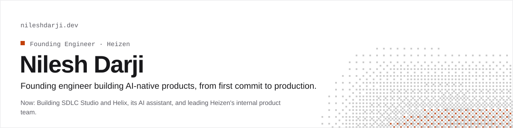
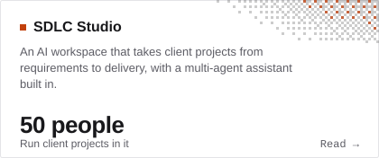
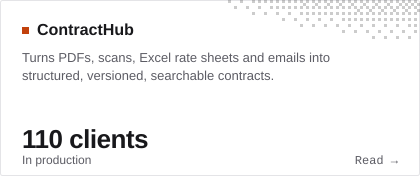
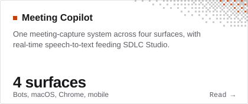
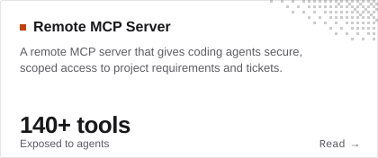
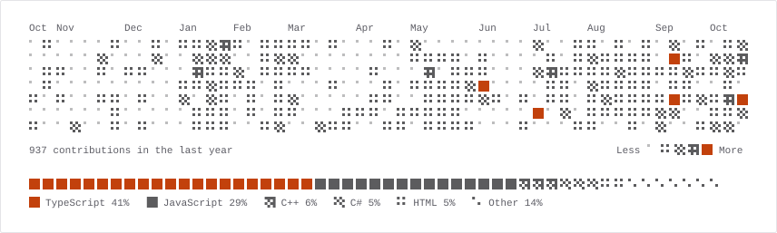

<!-- Generated from README.template.md by scripts/build.ts. Edit the template, not this file. -->

<a href="https://nileshdarji.dev"><picture><source media="(prefers-color-scheme: dark)" srcset="./assets/header-dark.svg"></picture></a>

<p><a href="https://nileshdarji.dev">Website</a> · <a href="https://nileshdarji.dev/resume.pdf">Resume</a> · <a href="https://www.linkedin.com/in/thenileshdarji">LinkedIn</a> · <a href="https://x.com/thenileshdarji">X</a> · <a href="mailto:nileshdarji282003@gmail.com">Email</a></p>

## Projects

<a href="https://nileshdarji.dev/projects/sdlc-studio/"><picture><source media="(prefers-color-scheme: dark)" srcset="./assets/project-sdlc-studio-dark.svg"></picture></a> <a href="https://nileshdarji.dev/projects/contracthub/"><picture><source media="(prefers-color-scheme: dark)" srcset="./assets/project-contracthub-dark.svg"></picture></a>
<a href="https://nileshdarji.dev/projects/meeting-copilot/"><picture><source media="(prefers-color-scheme: dark)" srcset="./assets/project-meeting-copilot-dark.svg"></picture></a> <a href="https://nileshdarji.dev/projects/remote-mcp-server/"><picture><source media="(prefers-color-scheme: dark)" srcset="./assets/project-remote-mcp-server-dark.svg"></picture></a>

## Open source

- [**markdown-to-doc**](https://github.com/Nilesh9106/markdown-to-doc): Converts Markdown into a styled Word (.docx) document in Node.js and Bun.<br><sub>590 npm downloads last month</sub>
- [**officetopdf-js**](https://github.com/Nilesh9106/officetopdf): Converts DOCX, PPTX and XLSX to PDF from JavaScript in Node.js, Bun, Deno and Electron.<br><sub>624 npm downloads last month</sub>

## Writing

- [Keeping an eye on production application logs with Grafana Loki](https://nileshdarji.dev/blog/keeping-an-eye-on-production-logs-with-grafana-loki/) <sub>Mar 2025</sub>

## Activity

<picture><source media="(prefers-color-scheme: dark)" srcset="./assets/contributions-dark.svg"></picture>

## Ask about my work

Questions about my work? [**Ask the AI on my site →**](https://nileshdarji.dev/#ask) It answers only from my projects and posts, with sources.

Or give your own agent the context:

```sh
curl https://nileshdarji.dev/llms.txt
```

<sub>Rebuilt daily from <a href="https://nileshdarji.dev">nileshdarji.dev</a> by a GitHub Action.</sub>
